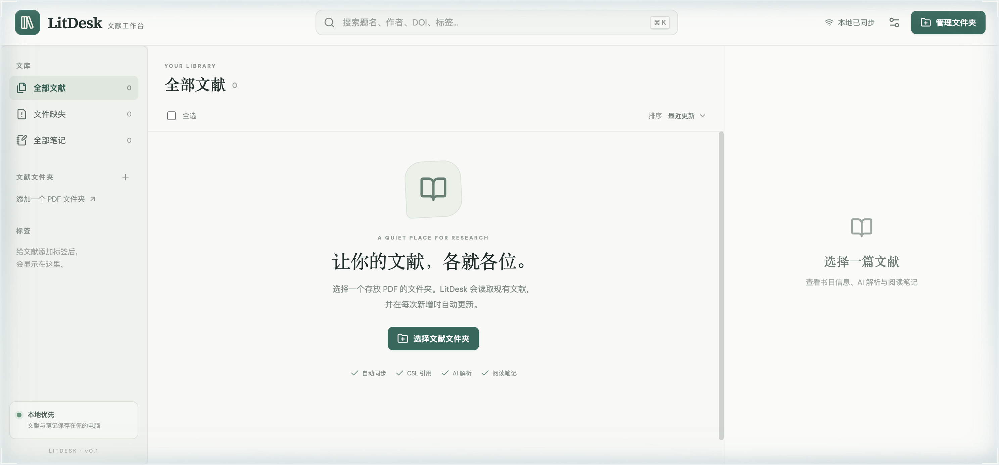

# LitDesk

**A quiet, local-first workspace for your literature.**

LitDesk is a Zotero-inspired desktop-style web app for managing a local PDF library, reading and taking notes, generating CSL citations, inserting citation fields into WPS/Word, and optionally summarizing papers with an OpenAI-compatible API.

[简体中文](README.zh-CN.md) · [Local deployment](#local-deployment) · [Citation fields](#citation-fields)



## Highlights

- **Watched folders** — recursively import existing PDFs and automatically detect additions, edits, renames, deletions, and restorations. Notes and metadata survive renames and missing files. Original PDFs are never moved or rewritten.
- **Library management** — full-text field search, folders, tags, sorting, editable bibliographic metadata, and optional DOI enrichment through Crossref. Chinese PDFs named `title_author_year.pdf` get reliable filename-first titles and years, with first-page author/journal extraction and CNKI cleanup.
- **Reading and notes** — built-in PDF.js reader with zoom and page navigation. Turn selected text into a note with its PDF page number. Notes support Markdown and autosave.
- **Real CSL citations** — multi-item in-text citations and bibliographies using Citeproc. Includes APA 7, GB/T 7714—2015 (numeric and author-date), IEEE, MLA 9, and Chicago author-date. Import additional `.csl` styles and export CSL JSON or BibTeX.
- **Citation fields with gray shading** — insert real fields rather than permanently highlighted text. Fields retain document IDs, style IDs, and citation kind.
- **Optional AI analysis** — summarize the research question, research design, data and samples, analysis methods, findings, and limitations, with source-page references. Save the result as a note.
- **Local by default** — loopback-only server, local SQLite database, bundled fonts, and no required cloud account.

## Online demo

Try the [hosted LitDesk demo](https://zc-ruc.github.io/-/litdesk/). It uses built-in sample documents and a browser mock API, so it does not read your local files, call a real AI provider, or automate Word/WPS. Changes reset when the page reloads. The full watched-folder, local database, real AI, and desktop integrations require the local deployment below.

## Local deployment

### Requirements

- macOS is recommended for native folder selection and WPS/Word insertion.
- Node.js **22.5 or newer**; Node.js 24 is recommended.
- npm and a modern browser.
- WPS Office and/or Microsoft Word only if you want application insertion.

The core library, reading, notes, CSL rendering, and export features also work on other platforms that support the required Node.js version. Native application automation is currently macOS-specific.

### Install and run

```bash
git clone https://github.com/Zc-RUC/litdesk.git
cd litdesk
npm ci
npm run build
npm start
```

Open **http://127.0.0.1:8765**.

On macOS you can also use the bundled launcher:

```bash
chmod +x start.command
./start.command
```

`start.command` installs dependencies when needed, builds missing frontend assets, starts the local service, and opens your browser.

For frontend development with Vite hot reload:

```bash
npm run dev
```

The Vite development page runs at `http://localhost:5173` and proxies API calls to the local server.

### First use

1. Select **Manage folders → Choose system folder**, or enter an absolute folder path.
2. Existing PDFs are scanned automatically. Keep the local service running to watch for new files.
3. Select a paper to edit metadata, read the PDF, create notes, or run AI analysis.
4. Select one or more papers and choose **Cite** (`Cmd/Ctrl + Shift + C`). Search anywhere with `Cmd/Ctrl + K`.

## AI configuration

Open **Settings** and enter an OpenAI-compatible Base URL, model name, and API key. Presets are provided for OpenAI, Kimi, DeepSeek, and a local model endpoint.

The configured service must support the `/chat/completions` endpoint. LitDesk only sends paper text after you explicitly test the connection, request an analysis, or use AI completion. To limit unnecessary input, analysis selects up to 10 relevant pages and 32,000 characters of source text, including abstract, methods, data, results, and conclusion sections, with an initial output budget of 9,000 tokens. Metadata completion reads up to two pages and 12,000 characters, asks only for missing fields, and starts with a 7,000-token output budget. If a model stops at its token limit, LitDesk retries once with up to 12,000 tokens, which consumes additional tokens, instead of parsing a truncated response. Scanned PDFs need OCR before AI analysis.

Reasoning models can take 1–3 minutes to respond. A progress bar shows the actual server-side stages: reading the PDF, preparing the excerpt, waiting for the model, and saving the result. The bar and its numeric percentage animate smoothly together; the model-waiting stage takes about 30 seconds to approach its target. This is visual interpolation between real task stages, not a measurement of the model's internal progress. Elapsed time and a **Cancel** button remain visible. Cancelling closes the upstream model connection, including during a token-limit retry, and leaves existing metadata and saved summaries unchanged. Changing papers, closing the tab, or losing the connection also stops the request. Each upstream request has a three-minute timeout; slow responses do not necessarily mean that your API key is not working.

### One-click AI metadata completion

Open a document's **Details** tab and click **One-click AI completion**. LitDesk reads up to the first two PDF pages and your existing bibliographic data, then fills missing authors, publication, DOI, abstract, language, pages, volume, issue, publisher, and URL fields. It **only fills empty fields and never overwrites existing values**, including manually edited metadata. The result reports exactly which fields changed, and AI-completed fields are protected from subsequent automatic PDF rescans. Repeated completion does nothing when no fields are missing. Scanned PDFs or files with too little extractable text return a clear OCR-required message instead of a fabricated result.

For multiple papers, select them in the library (including **Select all**) and click **Batch AI completion** in the selection toolbar. Papers are processed one at a time using the same field protection and token limits. The progress display shows the current paper, queue position, and overall progress. A failed paper is reported without stopping the rest of the queue. Cancelling stops the current request and remaining queue while preserving already completed changes.

You can also configure AI through environment variables:

```bash
export LITDESK_AI_BASE_URL="https://api.openai.com/v1"
export LITDESK_AI_MODEL="your-model-name"
export LITDESK_AI_API_KEY="your-api-key"
npm start
```

Environment variables take precedence over locally saved AI settings. Do not commit API keys to Git.

## Citation fields

1. Open the target WPS/Word document and place the cursor where the citation should appear.
2. Select papers in LitDesk and open **Citation Studio**.
3. Choose a CSL style and either **In-text citation** or **Bibliography**.
4. Click **Insert to WPS** or **Insert to Word**.

Inserted content is a real field. Clicking or selecting it can show light-gray field shading, depending on the application's field-shading setting.

- **WPS on macOS:** native OOXML field insertion has been tested for both in-text citations and multi-entry bibliographies. A temporary field document is copied through WPS itself, and LitDesk verifies the destination tab before pasting.
- **Microsoft Word:** field insertion is implemented but has not been verified.
- **Copy rich text:** produces ordinary formatted text, not a citation field.
- **Automatic refresh:** not currently available. The field stores LitDesk metadata, but it is not yet a live Zotero-style citation domain with full-document refresh.

## Local data and privacy

By default, application data is stored in `data/` inside the project:

- `data/litdesk.db` — documents, folders, notes, extracted text, and saved AI analyses.
- `data/local-settings.json` — local application settings, restricted to the current user where supported.
- `data/styles/` — user-imported CSL styles.

The `data/` directory is excluded from Git. Your PDF files stay in their original watched folders.

Available environment variables:

| Variable | Default | Purpose |
| --- | --- | --- |
| `PORT` | `8765` | Local HTTP port |
| `LITDESK_DATA_DIR` | `./data` | Alternate data directory |
| `LITDESK_AI_BASE_URL` | OpenAI API URL | OpenAI-compatible endpoint |
| `LITDESK_AI_MODEL` | empty | Model used for analysis |
| `LITDESK_AI_API_KEY` | empty | API credential |
| `LITDESK_AI_TEMPERATURE` | `0.2` | Sampling temperature; use `1` for models that require it |

The server listens on `127.0.0.1`, not a public interface. It is intended for a single local user, not for LAN or internet exposure.

## Current limitations

- Watched folders currently focus on PDF files.
- Scanned PDFs require OCR for text extraction and AI analysis.
- No cloud library sync, multi-user collaboration, or Zotero plugin compatibility layer.
- Citation fields do not yet support one-click refresh across a document.
- Native folder selection and WPS/Word automation currently target macOS.

## Project structure

```text
server/          Express API, SQLite, folder watching, PDF extraction,
                 CSL rendering, AI integration, field insertion
src/             React library, PDF reader, notes, citation and settings UI
server/csl/      Bundled CSL styles and locales
start.command    macOS launcher
```

## Third-party components

LitDesk uses [PDF.js](https://github.com/mozilla/pdf.js), [Citeproc](https://github.com/Juris-M/citeproc-js), official [CSL styles](https://github.com/citation-style-language/styles) and [locales](https://github.com/citation-style-language/locales), React, Express, Chokidar, DM Sans, and Source Serif 4. CSL style/locale metadata is retained in the bundled XML files; CSL resources are distributed under their original terms, including CC BY-SA 3.0 where applicable. PDF.js is Apache-2.0 licensed, and the bundled fonts use the SIL Open Font License.
